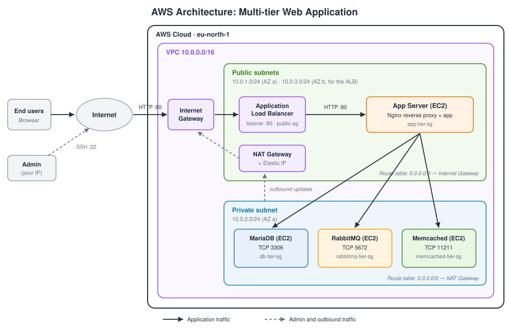
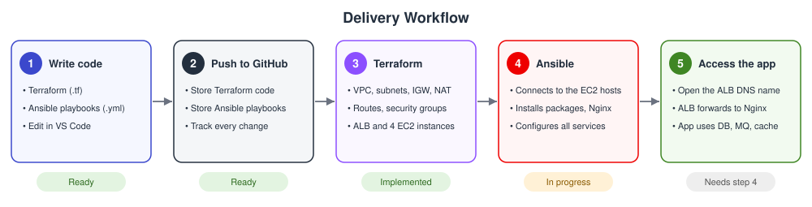

# Terraform + Ansible: Multi-Tier Web Application on AWS

A hands-on DevOps project that combines **Infrastructure as Code** (Terraform) with **configuration management** (Ansible) to build a production-style, multi-tier web application environment on AWS.

Terraform provisions the network, security rules, load balancer and four Linux servers. Ansible then configures what runs on those servers (Nginx, the application, MariaDB, RabbitMQ and Memcached), so no server is ever set up by hand.

## Project status

| Part | Status |
|---|---|
| Terraform: network, security groups, ALB, 4 EC2 instances | Implemented |
| Ansible: Nginx, application, MariaDB, RabbitMQ, Memcached | Implemented |
| End-to-end application access through the ALB | Implemented |

> Until Ansible installs Nginx on the app server, the ALB target is **unhealthy** and the ALB returns **503**. This is expected.

## Architecture

**Request path:** user, then Internet, then Internet Gateway, then the Application Load Balancer (port 80), then Nginx on the app server, then the application. The app server talks to MariaDB (3306), RabbitMQ (5672) and Memcached (11211) in the private subnet. Private servers reach the internet for updates only through the NAT Gateway.

## Delivery workflow

1. Write Terraform (`.tf`) and Ansible (`.yml`) code.
2. Push it to GitHub.
3. Terraform creates the AWS infrastructure.
4. Ansible connects to the instances and configures them.
5. Users reach the application through the ALB DNS name.

## What Terraform builds

| Area | Resources |
|---|---|
| **Network** | `aws_vpc.main`, public subnet, second public subnet (for the ALB, in another AZ), private subnet |
| **Routing** | Internet Gateway, public and private route tables with associations, Elastic IP and NAT Gateway, private default route through the NAT |
| **Security groups** | `public-tier-sg` (ALB), `app-tier-sg`, `db-tier-sg`, `rabbitmq-tier-sg`, `memcached-tier-sg` |
| **Load balancing** | Application Load Balancer, HTTP listener on port 80, target group with health checks, app instance registered as target |
| **Compute** | 4 Ubuntu 24.04 `t3.medium` instances: app (public subnet), MariaDB, RabbitMQ, Memcached (private subnet) |
| **Access** | EC2 key pair, SSH to the app server from the admin IP only, private servers reachable only through the app server |

## Security model
- **Least privilege:** each backend accepts traffic only from the app server's security group, never from CIDR ranges.
- **Private by default:** database, broker and cache have no public IP and sit in the private subnet.
- **Restricted administration:** SSH reaches the app server only from `admin_cidr`. The private servers are reached through it (jump host).
- **RabbitMQ management UI** (port 15672) is intentionally not exposed.
- **No secrets in Git:** state files, `*.tfvars` and key files are ignored (see `.gitignore`).

